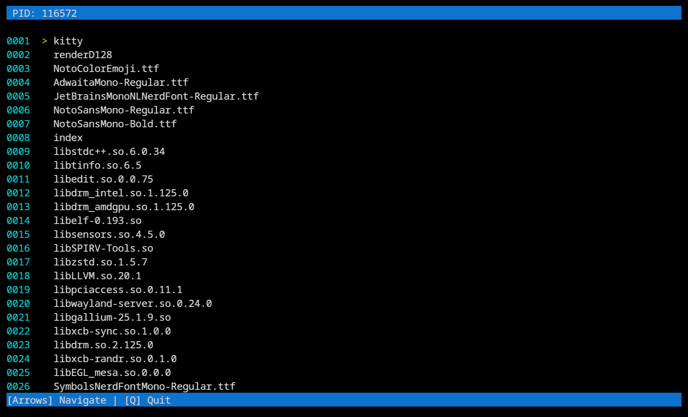

<div align="center">

# MemMapExplorer

**A utility for inspecting process memory**

[](https://en.wikipedia.org/wiki/C%2B%2B17)
[](#status)
[](LICENSE)

</div>

**MemMapExplorer** is a Linux utility for inspecting and visualizing process memory maps via the native `/proc/` interface. It provides an **interactive terminal-based interface** to explore loaded libraries, memory segments, and mappings, with filtering and navigation capabilities.



## Features

* **Interactive interface** with keyboard navigation
* **Structured memory map visualization** for processes
* **Filter loaded modules** by name
* **Option to show full path** or only filenames

## Prerequisites

Before building or running MemMapExplorer, ensure the following dependencies are installed:

* Linux system (Kernel 4.4 or later)
* **Ncurses** library (`libncurses-dev`)
* Modern **C++ compiler** supporting C++23

## Building and Running

```bash
# Clone the repository
git clone https://github.com/ItalianG0urmet/MemMapExplorer.git
cd MemMapExplorer

# Create build directory
mkdir build && cd build

# Configure with CMake
cmake ..

# Compile the project
make

# Run the application
./dumper -p <PID> [-f <filter>] [-a]
```

## Usage

| Option | Description                                   | Example     |
| ------ | --------------------------------------------- | ----------- |
| `-p`   | Specify the target PID                        | `-p 1234`   |
| `-f`   | Filter modules by substring                   | `-f "libc"` |
| `-a`   | Show full file paths (default: filename only) | `-a`        |

## Testing

MemMapExplorer includes automated tests for core components (PID validation, argument parsing, and memory map processing) using **GoogleTest**:

```bash
# Enable tests
cmake -DENABLE_TESTS=ON ..
make
ctest
```
